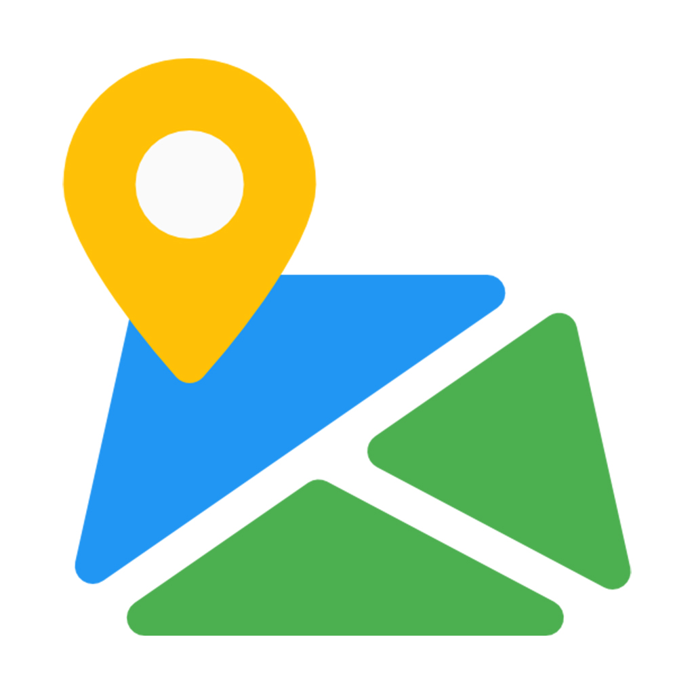

# Arazi Alan Ölçer - Landing Page

<div align="center">
  
    
   **GPS Destekli Arazi Ölçüm Uygulaması**
    
   [](https://apps.apple.com/tr/app/arazi-%C3%B6l%C3%A7me/id6740893569?l=tr)
</div>

## 📖 Hakkında

Bu repository, **Arazi Alan Ölçer** için resmi landing page'i içerir. GPS destekli iOS uygulaması olan Arazi Alan Ölçer, arazi alanlarını ölçmeye, mesafeleri hesaplamaya ve tarla sınırlarını belirlemeye yardımcı olur. Landing page, uygulama indirmelerini teşvik etmek, özellikler hakkında bilgi vermek ve yasal uyumluluğu sağlamak için tasarlanmıştır.

## 🌟 Özellikler

### Landing Page Özellikleri
- **SEO Optimizasyonu** - Meta etiketler, yapılandırılmış veri, Open Graph, Twitter Cards
- **Responsive Tasarım** - Mobil öncelikli yaklaşım ile hamburger navigasyon
- **App Store Entegrasyonu** - Resmi Apple "App Store'dan İndir" rozetleri
- **Marka Tutarlılığı** - Uygulamayla eşleşen özel renk şeması (#006ee6)
- **Performans Optimizasyonu** - Minimal bağımlılıklarla hızlı yükleme

### Yasal Sayfalar
- **Kullanım Şartları** - Uygulama kullanımı için kapsamlı yasal şartlar
- **Gizlilik Politikası** - GDPR/CCPA uyumlu gizlilik dokümantasyonu
- **Veri Toplamama** - Gizlilik öncelikli yaklaşım vurgusu

## 🎨 Tasarım

### Renk Şeması
- **Birincil**: #006ee6 (Mavi)
- **İkincil**: #0066cc (Koyu Mavi)
- **Vurgu**: #28a745 (Başarı durumları için Yeşil)
- **Arka Plan**: Beyaz (#ffffff)
- **Metin**: Koyu Gri (#333333)

### Tipografi
- **Font Ailesi**: -apple-system, BlinkMacSystemFont, 'Segoe UI', Roboto
- **Responsive**: Başlıklar için 2.5rem'den 3.5rem'e ölçeklenir
- **Erişilebilirlik**: Okunabilirlik için yüksek kontrast oranları

## 📁 Proje Yapısı

```
arazi/
├── index.html              # Ana landing page
├── terms-of-use.html       # Yasal şartlar ve koşullar
├── privacy-policy.html     # Gizlilik politikası ve veri işleme
├── field-area-measure-logo.png # Uygulama logosu/favicon
├── robots.txt              # Arama motoru yönergeleri
├── sitemap.xml             # Site haritası
└── README.md               # Proje dokümantasyonu
```

## 🔧 Kurulum ve Kurulum

### Ön Gereksinimler
- Web sunucusu (Apache, Nginx veya herhangi bir statik hosting)
- Test için modern web tarayıcısı

### Yerel Geliştirme

1. Repository'yi klonlayın:
```bash
git clone https://github.com/yourusername/arazi.git
cd arazi
```

2. Dosyaları yerel sunucu kullanarak sunun:
```bash
# Python 3 kullanarak
python -m http.server 8000

# Node.js kullanarak (http-server)
npx http-server

# PHP kullanarak
php -S localhost:8000
```

3. Tarayıcınızı açın ve `http://localhost:8000` adresine gidin

### Üretim Dağıtımı

Site statik HTML/CSS/JS'dir ve herhangi bir web hosting hizmetine dağıtılabilir:
- **GitHub Pages**
- **Netlify**
- **Vercel**
- **AWS S3 + CloudFront**
- **Geleneksel web hosting**

## 📱 Mobil Responsiveness

### Breakpoint'ler
- **Masaüstü**: ≥ 768px - Tam navigasyon menüsü
- **Mobil**: < 768px - Hamburger navigasyon menüsü

### Özellikler
- Dokunmatik dostu navigasyon
- Optimize edilmiş buton boyutları
- Küçük ekranlarda okunabilir tipografi
- Mobil ağlarda hızlı yükleme

## 🔍 SEO Optimizasyonu

### Teknik SEO
- **Meta Etiketler**: Başlık, açıklama, anahtar kelimeler, yazar
- **Yapılandırılmış Veri**: Uygulama bilgileri için JSON-LD
- **Open Graph**: Facebook/sosyal medya paylaşımı
- **Twitter Cards**: Gelişmiş Twitter paylaşımı
- **Canonical URL'ler**: Yinelenen içerik önleme
- **App Store Meta**: iOS için akıllı uygulama banner'ları

### İçerik SEO
- **Anahtar Kelime Hedefleme**: GPS arazi ölçümü, tarla alan hesaplayıcı
- **Uzun Kuyruk Anahtar Kelimeler**: "GPS alan ölçüm uygulaması", "tarla sınır hesaplayıcı"
- **İçerik Derinliği**: Uygulama özellikleri hakkında kapsamlı bilgi
- **İç Bağlantılar**: Bağlantılı yasal sayfalar

### Performans
- **Minimal Bağımlılıklar**: Harici framework'ler yok
- **Optimize Edilmiş Görseller**: Sıkıştırılmış logo ve rozetler
- **Hızlı Yükleme**: < 2s yükleme süresi hedefi
- **Mobil Öncelikli**: Mobil cihazlar için optimize edilmiş

## 🎯 Ana Sayfalar

### 1. Landing Page (`index.html`)
- Uygulama logosu ve ana CTA ile hero bölümü
- 6 ana fayda ile özellik vitrini
- 3 adımlı nasıl çalışır süreci
- Kullanıcı yorumları
- SEO içerik bölümü
- Resmi App Store rozetleri ile indirme CTA'ları

### 2. Kullanım Şartları (`terms-of-use.html`)
- 18 kapsamlı yasal bölüm
- Abonelik şartları ve otomatik yenileme politikaları
- Kullanıcı davranış yönergeleri
- Ölçüm doğruluğu sorumluluk reddi
- GPS ve konum hizmeti şartları

### 3. Gizlilik Politikası (`privacy-policy.html`)
- Gizlilik öncelikli yaklaşım dokümantasyonu
- "Veri toplamama" vurgusu
- Konum hizmetleri kullanım açıklaması
- Apple App Store entegrasyon detayları
- GDPR/CCPA uyumluluğu

## 🛠 Kullanılan Teknolojiler

- **HTML5**: Semantik markup ve yapı
- **CSS3**: Flexbox ve Grid ile modern stillendirme
- **JavaScript**: Hamburger menü işlevselliği
- **Responsive Design**: Media query'ler ve mobil öncelikli yaklaşım
- **SEO**: Meta etiketler, yapılandırılmış veri ve optimizasyon

## 📊 Analitik ve Takip

Landing page analitik için hazır olarak tasarlanmıştır ancak gizliliği korumak için varsayılan olarak takip içermez. Ekleyebileceğiniz özellikler:
- Google Analytics 4
- Facebook Pixel
- Apple Search Ads attribution
- Özel dönüşüm takibi

## 🚀 Performans Optimizasyonları

- **Minify Edilmiş Varlıklar**: Kritik yol için inline CSS
- **Optimize Edilmiş Görseller**: Sıkıştırılmış PNG logo
- **Lazy Loading**: Uygulama için hazır
- **CDN Hazır**: Global CDN'e dağıtılabilir
- **Önbellek Başlıkları**: Optimal önbellek stratejileri

## 📈 Dönüşüm Optimizasyonu

### Call-to-Action Stratejisi
- **Birincil CTA**: App Store indirme rozetleri
- **Çoklu CTA'lar**: Hero bölümü ve alt bölüm
- **Görsel Hiyerarşi**: İçerik boyunca net ilerleme
- **Güven Sinyalleri**: Yorumlar ve gizlilik vurgusu

### Kullanıcı Deneyimi
- **Net Navigasyon**: Tüm bölümlere kolay erişim
- **Hızlı Yükleme**: Dönüşüme minimal sürtünme
- **Mobil Optimize**: Dokunmatik dostu arayüz
- **Profesyonel Tasarım**: Güven ve güvenilirlik oluşturur

## 🔗 App Store Bilgileri

- **Uygulama ID**: 6740893569
- **App Store URL**: https://apps.apple.com/tr/app/arazi-%C3%B6l%C3%A7me/id6740893569?l=tr
- **Geliştirici**: Asil Arslan
- **Destek E-posta**: asilarslan93@gmail.com
- **Kategori**: Yardımcı Programlar
- **Yaş Derecelendirmesi**: 4+
- **Fiyatlandırma**: Uygulama İçi Satın Almalarla Ücretsiz

### Uygulama İçi Satın Almalar
- Haftalık Plan: $4.99
- Yıllık Plan: $24.99

## 📱 Uygulama Özellikleri

### Temel İşlevsellik
- **GPS Alan Hesaplama** - Anında alan ve mesafe ölçümleri
- **Çoklu Birimler** - Metrekare, hektar, dönüm, kare feet
- **GPS ve Manuel Ölçüm** - Esnek nokta yerleştirme seçenekleri
- **Kaydet ve Rapor Dışa Aktar** - PDF ve CSV dışa aktarma yetenekleri
- **Çevrimdışı Mod** - İnternet bağlantısı olmadan çalışır
- **Kolay Arayüz** - Tüm beceri seviyeleri için sezgisel tasarım

### Hedef Kullanıcılar
- **Çiftçiler ve Agronomistler** - Çiftlik arazilerini ve ekin alanlarını ölçme
- **İnşaat Profesyonelleri** - İnşaat sahalarını ve mülk sınırlarını hesaplama
- **Haritacılar ve Mühendisler** - Hassas arazi ölçümleri alma
- **Emlak Acenteleri** - Mülk değerlendirmesi ve sınır belirleme
- **Açık Hava Tutkunları** - Yollar, parklar ve rekreasyon alanlarını ölçme

## 📞 İletişim ve Destek

- **Geliştirici**: Asil Arslan
- **E-posta**: asilarslan93@gmail.com
- **Website**: https://arazi.app/
- **App Store**: [Arazi Alan Ölçer](https://apps.apple.com/tr/app/arazi-%C3%B6l%C3%A7me/id6740893569?l=tr)

## 📄 Lisans

Bu landing page, Arazi Alan Ölçer uygulaması tanıtımı için özel yazılımdır.

## 🔄 Güncellemeler ve Bakım

### Versiyon Geçmişi
- **v1.0** - Responsive tasarım ile ilk landing page
- **v1.1** - Kullanım Şartları ve Gizlilik Politikası sayfaları eklendi
- **v1.2** - Marka rengi entegrasyonu ve logo optimizasyonu

### Gelecek Geliştirmeler
- [ ] SEO içeriği için blog bölümü
- [ ] Çoklu dil desteği
- [ ] Gelişmiş analitik entegrasyonu
- [ ] A/B test framework'ü
- [ ] Ek uygulama ekran görüntüleri
- [ ] Video eğitim bölümü

---

<div align="center">
    <p><strong>GPS hassasiyet teknolojisi ile araziyi ölçün ve alanı anında hesaplayın.</strong></p>
    
    [](https://apps.apple.com/tr/app/arazi-%C3%B6l%C3%A7me/id6740893569?l=tr)
</div>
